Almost everything I know starts and stops. A song ends. A phone battery dies. A startup launches, grows, and one day shuts down. Even the sun has a start date, and someday an end date.

Time doesn't. It just keeps going, at the same pace, for everyone. You can't pause it, speed it up, or put some aside for later.

That last part has bugged me for a while. We store almost everything else. Food for the lean months. Money for retirement. Photos for nostalgia. Files for some future version of ourselves who will apparently have the time to sort them. But time itself slips through. Every hour you spend is gone the moment you spend it.

So here's the question this whole piece is about: **how do we capture time?**

And the follow-up, which sounds obvious until you sit with it: **would that even be wonderful?**

Imagine you could. Picture a jar on your shelf with ten years in it. Not ten years of free time to lie around in. Ten years of practice. Ten years of watching how things play out. Ten years of being wrong and finding out why. You'd open it the moment you needed it, in a meeting, in a pitch, on a cricket field, and spend all ten years in a second.


That would be the most useful thing anyone ever owned.

Storytellers have been imagining this for a long time. So before the science, let's look at what they came up with. Almost every version teaches us something about what storing time would really take.

In *Harry Potter and the Prisoner of Azkaban*, Hermione gets a Time-Turner, a tiny hourglass that lets her go back and replay hours. She uses it all year to attend classes that run at the same time ([Muggles' Guide, chapter 21](https://en.wikibooks.org/wiki/Muggles%27_Guide_to_Harry_Potter/Books/Prisoner_of_Azkaban/Chapter_21)).

That's storing time in the most literal way: extra hours on demand. And it mostly just makes her tired. By the end of the year she gives it back. Extra hours are a bigger bucket, not a better one.

The same books have a second go at it. Dumbledore's Pensieve is a stone basin where you can pour out a memory and later step back inside it, watching the past from the corner of the room ([HP Lexicon](https://www.hp-lexicon.org/?p=6820)).

It's a perfect archive. Nothing fades, nothing gets rewritten. But watching a memory as a ghost in the corner doesn't make you better at anything. The archive holds what happened. It doesn't hold what you'd learn from doing it. Keep that split in mind, because it turns out to be real.

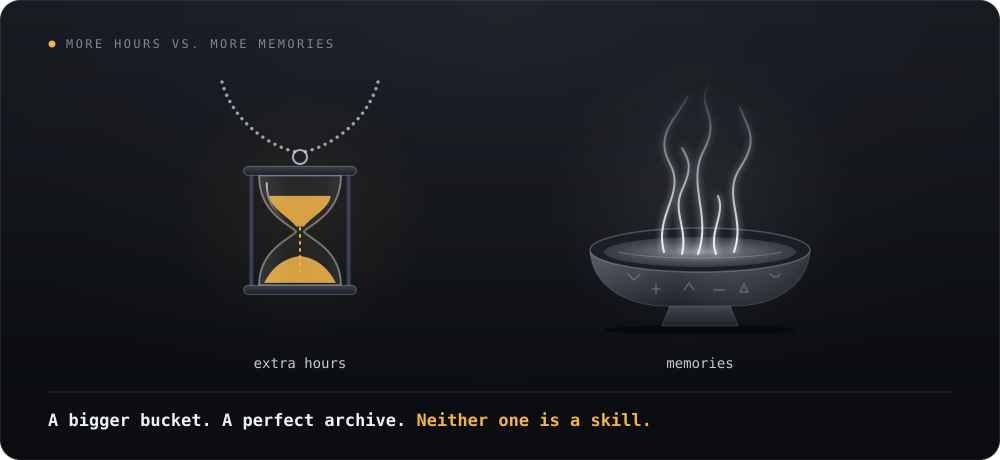

Other stories try something stranger: they make you live the same day again and again. In Hiroshi Sakurazaka's 2004 novel *All You Need Is Kill*, later the Tom Cruise film *Edge of Tomorrow*, a raw recruit dies in his first battle and wakes up the day before. Then again. And again. Each death teaches him something: where the enemy will be, which weapon jams, which move works. In the novel, the battle is finally won on the 160th loop ([All You Need Is Kill, summary](https://en.wikipedia.org/wiki/All_You_Need_Is_Kill)).

This one asks the question I care about most. If failure is tuition, how many failures does it take? Is there a number?


Then there's the shortcut. In *The Matrix*, Neo has martial arts programs uploaded straight into his brain ([Looper](https://www.looper.com/160020/lines-in-the-matrix-movies-that-mean-more-than-you-realized)). He opens his eyes and says the line everyone remembers: "I know kung fu." Then Morpheus takes him into a sparring program and beats him anyway.

<figure>
  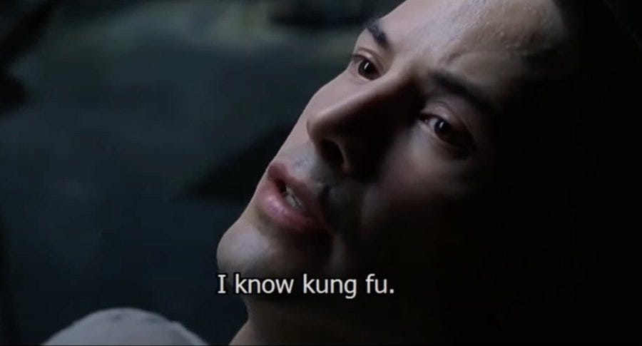
  <figcaption>Still from <em>The Matrix</em> (1999), Warner Bros.</figcaption>
</figure>

Morpheus later tells him there's a difference between knowing the path and walking the path. I think that's the deepest line in any of these stories. You can download know-how. You can't download having lived it.

I've been playing with a version of this about Roger Federer. Say you could copy every one of his skills into a new player. That player would still decide differently from Federer. They wouldn't have his history of mistakes, his body-specific tuning, or the stakes he lived through. The skill transfers. The experience doesn't.

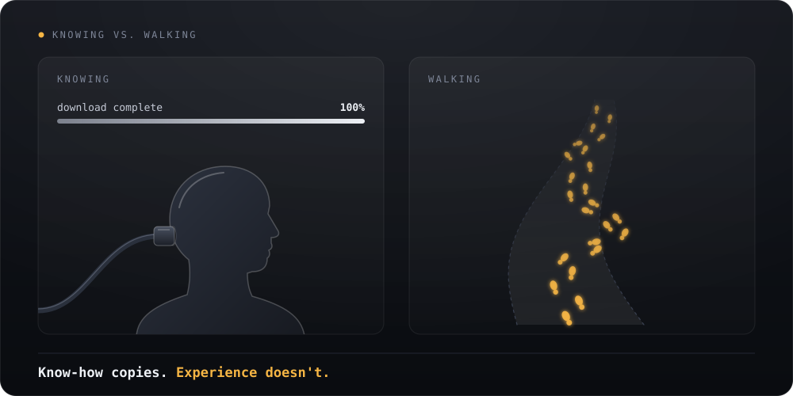

My favourite loop of all is Groundhog Day. Phil Connors, a grumpy TV weatherman, wakes up on the same February 2nd again and again. First he exploits it. Then he despairs. Then he gets curious. He learns the piano, ice sculpting and French poetry. He memorises the whole town: who drops what, who trips where, which kid falls out of which tree and when.

Nobody knows how long he's stuck. The director, Harold Ramis, first said about ten years, then later suggested 30 to 40. One fan estimate, counting how long his skills would take to learn, landed on 33 years and 350 days ([Yahoo](https://www.yahoo.com/entertainment/article/how-long-phil-connors-stuck-in-groundhog-day-101536956.html)).

Here's what makes Phil's loop special, and we'll come back to it: it's the kindest classroom ever built. The same day, every day. Instant results. Unlimited retries. Nothing changes except him.

Line them up and a pattern shows. The story that stores *hours* (the Time-Turner) just gives you a bigger bucket. The one that stores *memories* (the Pensieve) gives you an archive, not an ability. The one that *downloads* skill (The Matrix) still has to make you walk the path.


The stories that work are the loops. And notice what Phil and the soldier actually carry forward. Not the hours. They carry what the hours taught them. Phil doesn't have 30 years in a jar. He has a pianist's hands and a whole town's routine in his head.

That thing, the residue of time spent learning, is real. We all have some. We just call it something else.

The psychologist Gary Klein spent years interviewing firefighters about how they make decisions. One story stuck with him.

A lieutenant and his crew went into a house for what looked like a simple kitchen fire. They sprayed water on it. Nothing happened. They sprayed again. Still nothing. And suddenly the lieutenant ordered everyone out. No reason given. Moments after they got out, the floor they had been standing on collapsed. The real fire was in the basement, right under their feet.

The lieutenant believed he had ESP. It took Klein hours of questions to dig out what he had actually noticed. The water wasn't working. The living room was far too hot for a small kitchen fire. And the fire was strangely quiet. He hadn't put any of that together consciously. One of the cues wasn't even a thing. It was an absence, a noise that should have been there and wasn't ([Klein's story, via Fire Engineering](https://emberly.fireengineering.com/?p=219433)).


That's not ESP. That's what stored time looks like when you open the jar.

The economist and psychologist Herbert Simon had the cleanest explanation I've found. A situation gives you a cue. The cue opens something stored in memory. And that stored thing is the answer. In his words, intuition is "nothing more and nothing less than recognition" (quoted in [Kahneman & Klein 2009](https://pubmed.ncbi.nlm.nih.gov/19739881/)). Klein found his fire commanders worked exactly this way. They rarely compared options. They recognised the situation, took the first option that fit, and quickly played it out in their heads ([Klein 2008](https://library.alnap.org/system/files/content/resource/files/main/Klein_2008_HF_NDM.pdf)).

Chess shows the storage most clearly. In the classic experiments, players looked at a real game position for just a few seconds and then rebuilt it from memory. Masters got about 93% of the pieces right. Novices got about a third. Then the researchers scattered the same pieces randomly, in positions that could never happen in a real game. Now everyone, masters included, recalled only three or four pieces ([Simon & Chase 1973](https://www.Gwern.net/doc/psychology/chess/1973-simon.pdf)).

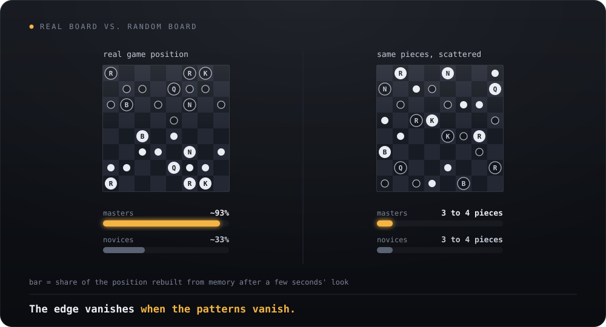

So masters don't have better memories. They have a library. Simon and Chase estimated it at around 50,000 familiar patterns, built over something like 10,000 to 50,000 hours of looking at chess. And the library does most of the work. Garry Kasparov's playing strength barely dropped when he played several strong opponents at once, with almost no time to think about each move ([Gobet & Simon 1996](https://bura.brunel.ac.uk/handle/2438/1338)).

This is the jar from the opening. Every hour of practice left a pattern behind. Years later, one glance pulls up thousands of them at once.

It also settles something that used to confuse me. Someone who chooses on the spot and someone who studies a choice for years look impossible to compare. But often the quick chooser did study. They just did it years earlier, and they're spending it now, in a second.

If instinct is stored time, why does it feel like it came from nowhere?

There's a famous patient in neuroscience, known for decades only as H.M. After brain surgery, he could barely form new conscious memories. The researcher Brenda Milner gave him a tricky task: trace a star while looking only at its reflection in a mirror. Over 30 tries across three days, he got much better. Yet every time, he had no memory of ever having done it before ([Milner's study, via an intro neuroscience text](https://pressbooks.atlanticoer-relatlantique.ca/intropsychneuro/chapter/introduction-to-memory/)).

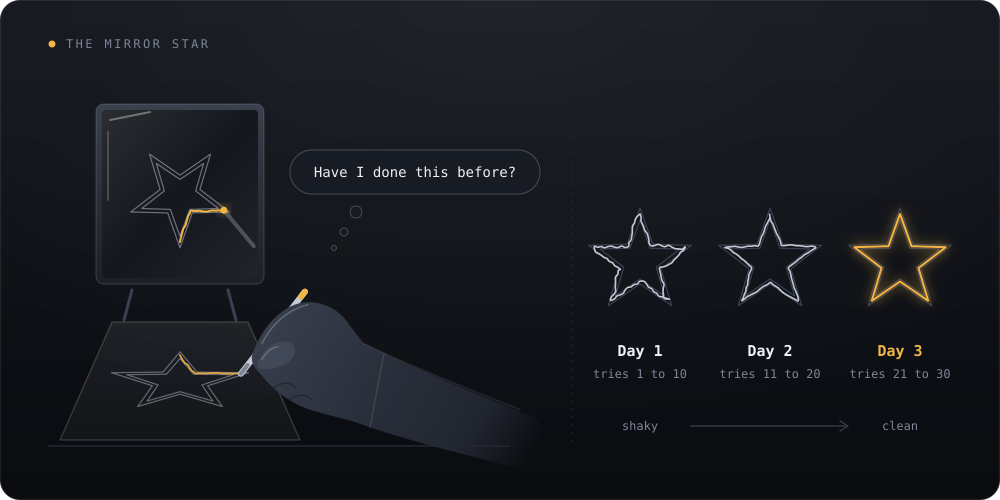

H.M. had Phil Connors' hands without Dumbledore's Pensieve. The skill was stored. The memory of earning it was not. Our brains keep those two in separate places, which is exactly why a gut feeling shows up without its receipts.

So how does time actually get into the jar? Not through one neat mechanism. Through several, and most of them work while you aren't paying attention.

The first is that you pick up patterns you never meant to learn. In the 1960s, the psychologist Arthur Reber asked people to memorise strings of letters. That's all they were told to do. What they weren't told was that the strings followed a hidden grammar. Later, shown brand-new strings, they could tell which ones "fit" better than chance. Ask them for the rules, though, and they had nothing ([artificial grammar learning, summary](https://en.wikipedia.org/wiki/Artificial_grammar_learning)). Some researchers think they stored little two- and three-letter fragments rather than real rules. Either way, they learned more than they set out to.

You do this all the time. It's how a sentence in your first language can sound wrong before you could name the rule it breaks. You're banking patterns even when you think you're just getting through the day.

The second is that a lot of what you store never turns into words. The philosopher Michael Polanyi put it in one line: "we can know more than we can tell" ([Polanyi's paradox](https://en.wikipedia.org/wiki/Polanyi%27s_paradox)). His example was a face. You can pick a friend out of a crowd of thousands, but try describing exactly how.

My favourite example is the chick sexer. These are people who sort day-old chicks into male and female, a job that matters to poultry farms and is famously hard. The best ones hit close to 98% accuracy at around a thousand chicks an hour. Ask how they do it and many will tell you they have no idea ([Horsey 2002](https://gwern.net/doc/psychology/vision/2002-horsey.pdf); [Pacific Standard](https://psmag.com/magazine/the-lucrative-art-of-chicken-sexing/)). The knowledge is real. It just never passed through words.

The third is that you start seeing things earlier. This will make sense to anyone who has faced a fast bowler. Researchers showed cricket batsmen of different levels video of bowlers, cutting the clip off at different moments. Everyone used the ball's flight. But the best batsmen also read the bowler's hand and arm, *before the ball was released*. Weaker batsmen simply didn't pick those cues up ([Müller, Abernethy & Farrow 2006](https://vuir.vu.edu.au/8058)).


A review of 42 sport studies found the same thing across games. Experts spot the useful cues, answer faster and more accurately, and look at fewer things for longer ([Mann et al. 2007](https://pubmed.ncbi.nlm.nih.gov/17968048/)). Experts don't really react faster. They start earlier.

That's the soldier in *Edge of Tomorrow*, who knows where the enemy will land before it lands. Stored time, spent as a head start. The expert lives a fraction of a second in the future.

Some of the storing may even happen while you sleep. In one study, people practised a number task that had a hidden shortcut. More than twice as many found the shortcut after a night's sleep than after the same hours awake ([Wagner et al. 2004](https://research.uni-luebeck.de/en/publications/sleep-inspires-insight/)). Sleep seemed to reorganise what they had practised.

I have to be honest about the other famous sleep result, though. People got about 20% faster at a finger-tapping sequence after sleeping on it ([Walker et al. 2002](https://walkerlab.berkeley.edu/reprints/Walker%20et%20al._Neuron_2002.pdf)). A later review argued most of that boost was a quirk of how it was measured. Sleep may protect a skill more than it improves it ([Rickard & Pan 2017](https://sc-pan.github.io/pdf/RP_PB_2017.pdf)).

And sometimes your body notices before you do. In the Iowa gambling task, people draw cards from four decks. Two decks are quietly rigged to lose money over time. Healthy players' skin started reacting to the bad decks after about the 10th card. They reported a hunch around the 50th card. They could explain the pattern around the 80th ([Bechara et al. 2005](https://stanford.edu/~jlmcc/papers/BecharaEtAl05_TiCS.pdf)). Other researchers found people knew more, earlier, than that account claimed ([Maia & McClelland 2004](https://stanford.edu/~jlmcc/papers/MaiaMcC04.pdf)). So maybe the body isn't revealing what you don't know. Maybe it's voicing what you half-know.


Either way, a gut feeling looks like the early voice of a pattern you're still learning.

And there's one ingredient running through all of this. It's the thing the loop stories got right without saying so.

Go back to Phil Connors. Why does he get so good at everything? It isn't only the years. It's that every single thing he tries gets an answer by the end of the day. Say the wrong thing to Rita, and he knows by dinner. Mistime the catch, and the kid hits the ground. Same day, same people, instant results.

Daniel Kahneman, the great sceptic of intuition, and Gary Klein, its great champion, once sat down to find where they disagreed. They mostly couldn't. They agreed intuition can be trusted under two conditions. The world has to be regular enough to predict. And you need a real chance to learn it, through lots of practice with feedback ([Kahneman & Klein 2009](https://pubmed.ncbi.nlm.nih.gov/19739881/)).

The psychologist Robin Hogarth has nice names for the two ends. A **kind** world gives you fast, accurate feedback. A **wicked** world gives it late, or never, or gives you the wrong lesson ([Hogarth, Lejarraga & Soyer 2015](https://pure.mpg.de/pubman/item/item_2225074_9/component/file_3569491/Hogarth_TheTwo_2015_VerlPDF_final_LS.pdf)). Phil lives in the kindest world imaginable. Most of us don't.

Here's the part that unsettled me. Without feedback, experience can make you *worse*.

One study followed 170 therapists treating 6,591 clients over as long as 18 years. On average, their clients' results slightly declined as the therapists got more experienced. Some therapists improved. Most didn't ([Goldberg et al. 2016](https://div12.org/?p=5528)). A review of doctors found a similar slide on many measures of care ([Choudhry et al. 2005](https://pmc.ncbi.nlm.nih.gov/articles/PMC549143/)). These are smart, caring people putting in real hours. But a therapist rarely learns how a client is doing five years later. The hours pile up. The answers don't arrive.

And slow feedback hurts instinct in particular. In one lab study, delaying feedback didn't stop people learning categories they could describe with a simple rule. But it badly hurt their learning of categories that had to be *felt* rather than stated. They fell back on clumsy verbal rules instead ([Maddox, Ashby & Bohil 2003](https://labs.psych.ucsb.edu/ashby/gregory/node/249)). The part of you that builds instinct is the part slow feedback hurts most.

So here's how I'd put it now. **Instinct is roughly the number of cases you've lived, multiplied by how honest the feedback was on each one.** Time only matters because it's where the cases come from. One year with lots of honest answers stores more than ten years with none.


Phil's loop sits in the top-right corner, the kindest world there is. Big product bets sit bottom-left. But some slices of product work, like onboarding and copy, can be pulled up and to the right just by testing often.

The soldier in *All You Need Is Kill* needed about 160 deaths. Phil needed somewhere between ten and forty years. I wanted a number for real life too. Do you have to fail a certain number of times to succeed the next time? What is that n?

I looked hard, and the honest answer is that there's no clean n. But the research does give three useful half-answers.

The first half-answer is about failure itself. In 2019, a team of researchers worked out the sweet spot for learners that improve by making small corrections after each mistake. Learning was fastest when the learner got about 15.87% of answers wrong. That's roughly one miss in every six tries. They called it the Eighty Five Percent Rule ([Wilson et al. 2019](https://escholarship.org/content/qt0v22s4g4/qt0v22s4g4.pdf?t=sdxgqm)).


The fine print matters. They proved it for simple yes/no judgments, using model learners: a perceptron, a small neural network, a model of how monkeys learn to see. Change the assumptions and the sweet spot moves to somewhere between 75% and 82% correct. So don't treat it as law for humans. Treat it as a strong hint about difficulty. If you never fail, the task is too easy to teach you much. If you fail half the time, it's too hard to learn from.

Other research points the same way. Robert and Elizabeth Bjork call it "desirable difficulties". Spacing practice out, mixing topics and testing yourself all *feel* worse than easy repetition, but they make learning last. The catch is that a difficulty only helps if you can actually respond to it ([Bjork & Bjork 2023](https://www.unh.edu/teaching-learning-resource-hub/sites/default/files/media/2023-06/itow-introducing-desirable-difficulties-into-practice-and-instruction-bjork-and-bjork.pdf)). Manu Kapur's work on "productive failure" goes further. Across 53 studies, students who wrestled with a problem *before* being taught the method understood it more deeply than students taught first ([Sinha & Kapur 2021, summary](https://phys.org/news/2021-09-productively-wiser.html)). But those failures were designed. The problems were picked to expose exactly the idea about to be taught.

The soldier's loop is actually a decent model. Hard enough that he dies. Not so hard that he learns nothing from dying.

The second half-answer is that there's no finish line. The oldest finding about practice is that each extra try helps, but a bit less than the last one ([Newell & Rosenbloom 1981](https://aitopics.org/doc/classics:7D0BECCD)). Gains come fast early, then keep shrinking. A big reanalysis of 7,910 individual learning records argued over the exact shape of that curve ([Heathcote, Brown & Mewhort 2000](https://scispace.com/pdf/the-power-law-repealed-the-case-for-an-exponential-law-of-3ur3vq1jx1.pdf)). But every version agrees on the part that matters here. There's no trial where intuition suddenly switches on. "Reliable" is a level you pick, not a line you cross.

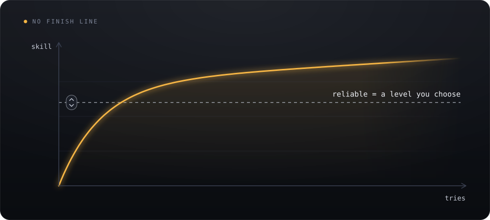

The third half-answer comes from the few places where researchers actually counted. In the gambling task, the hunch showed up around card 50. In one small flight study, college students did about 250 quick, instantly scored trials of reading cockpit instruments. In roughly an hour, they matched the accuracy of pilots with 500 to 2,500 flying hours, on that one skill ([Kellman & Kaiser 1994](https://kellmanlab.psych.ucla.edu/wp-content/uploads/sites/357/2025/09/kellman_kaiser_1994.pdf)).

Surgery is slower. Across 7,765 prostate cancer patients and 72 surgeons, the cancer came back in 17.9% of patients whose surgeon had done 10 earlier operations. That fell to 10.7% for surgeons with 250 behind them, and then the curve flattened ([Vickers et al. 2007, via EurekAlert](https://www.eurekalert.org/news-releases/607461)).

At the far end are music and chess. The best young violinists at a Berlin music academy had put in over 10,000 hours of practice by age 20. The least accomplished group had about 5,000 ([Ericsson 2006](https://www.ida.liu.se/~nilda/Anders_Ericsson/Ericsson_delib_pract.pdf)). Elite musicians often needed 20 to 30 years to reach the top, which makes Ramis's later guess about Phil look surprisingly realistic. And chess grandmasters' practice ranged from 832 hours to 24,284. That's about a 30-fold spread. Meanwhile 13% of merely intermediate players had practised more than the average grandmaster ([Hambrick et al. 2014, via BPS](https://www.bps.org.uk/research-digest/exploding-10000-hours-myth-its-no-guarantee-greatness)).


So what sets n? Mostly three things. How many patterns the world holds: the gambling task has four decks, chess has tens of thousands of positions. Who you are: the spread between people is huge. And how well your practice is designed: an hour of focused drills stood in for hundreds of hours in a cockpit.

One more question I kept coming back to. Do you need lots of different experiences, or lots of experience of the one thing?

Mostly the second, but with a twist. Training in chess, music or memory games did little for children's general thinking or school results ([Sala & Gobet 2017](https://eprints.lse.ac.uk/102204)). Remember the masters who forgot random boards. Expertise doesn't leak far outside its home.

But variety *inside* the skill helps a lot. Children who practised throwing a beanbag at two different distances ended up more accurate at a third distance than children who'd practised only that one ([Kerr & Booth 1978, summary](https://coachsci.sdsu.edu/csa/vol31/kerr.htm)). People learning to recognise 12 painters' styles did far better when the paintings came mixed together: 61% correct on new paintings, against 35% when each painter's work came in a block. The funny part is that 78% of them believed the blocked way had worked as well or better ([Kornell & Bjork 2008](https://bjorklab.psych.ucla.edu/wp-content/uploads/sites/13/2016/07/Kornell_Bjork_2008_PsychScience.pdf)). And across 51 studies of athletes, the world-class adults had usually played more different sports as kids and progressed more slowly at first. The best juniors showed the opposite pattern ([Güllich, Macnamara & Hambrick 2022, via APS](https://www.psychologicalscience.org/observer/making-champions)).


So the answer is: **many varied cases of the same thing**. Variety teaches you the category, not just the example.

So, do you have to fail n times before you succeed? Not as a toll you pay. A failure only counts if you find out it was a failure, and why. A failure you never hear about counts as zero. A misleading one counts as less than zero.

If I had to turn all this into one rule, it's my own reading of the evidence, not a finding: plan to miss about once in every five to seven tries, near the edge of what you can do, with fast and honest feedback. How many tries you need in total then depends on how big the world is and how clean the feedback is.

None of us gets Phil's loop. But we can borrow its features. The same kind of situation, many times. Answers that come back fast. Misses near the edge of what we can do. And a record that doesn't lie.

Even a wicked job has kind corners. In product work, whether a new user will finish onboarding is something you learn in days. So is which headline gets more clicks, or what someone will say next in a user interview. Whether a market will exist in three years, you might not learn for years, and the lesson will be muddy when it comes. Train your instinct on the first kind of question. Use slow, careful analysis on the second.

Real life spreads cases thin. Remember the students who matched pilots after an hour of scored drills? You can make drills too. Replay old user sessions and predict what the person does before you watch. Guess a metric before you open the dashboard. Name the cause of a support ticket before you read its tag. Each one is a tiny Groundhog Day: a case, a call, an answer, all inside a minute.


Then tune the difficulty. If you're right almost every time, make it harder: finer calls, less information, less time. If you're wrong half the time, step back. You're aiming for the soldier's sweet spot, missing about once in six.

Don't practise one type of case in a block. Mix them, the way the painting study did, even though blocks will *feel* more productive.

Spread your practice out too. In a study of 1,354 people, the best gap between study sessions depended on how long you needed to remember. For a test a week away, it was about 20–40% of that week. For a test a year away, it was 5–10% of the year. Getting the gap right beat cramming by up to 111% ([Cepeda et al. 2008](https://www.evullab.org/pdf/CepedaVulRohrerWixtedPashler-PS-2008.pdf)). For instincts you want to keep for years, come back to a type of case every few weeks rather than every day.

And make your call *before* you read the expert's take or the post-mortem. That's productive failure on a small scale. Then compare. Then sleep on it, which seems to help the lesson settle, even if it doesn't make you faster.

If I could keep only one habit from all this, it would be a hunch log.

It's simple. When you get a gut feeling about something that will or won't happen, write it down before you know the answer. Note the date, the call, how confident you are as a percentage, the cue you think you noticed, and when you'll know. Something like: *"This onboarding change will lift day-one completion. 70%. Cue: users kept stalling on the permissions screen. Check in two weeks."*


When the answer comes in, score it. The simplest score is the Brier score: take your confidence as a number between 0 and 1, subtract what happened (1 if it happened, 0 if not), and square it. Zero is perfect. Saying "50%" about everything earns 0.25, so you want to beat that.

This isn't a productivity hack I made up. It's how the best forecasters train. In a large forecasting tournament, the top 2%, dubbed "superforecasters", made about 7.8 forecasts per question, updating as news came in. Everyone else averaged fewer than two. A 45-minute training session also improved forecasters' accuracy, and the gain held for months ([Mellers et al. 2014](https://escholarship.org/content/qt4rg4n9vr/qt4rg4n9vr_noSplash_4ff67e56b3dac616e0163b75090705e6.pdf)). Older studies found that people given feedback on their confidence, over 200-question tests, became better calibrated on new questions later ([Lichtenstein & Fischhoff 1980](https://apps.dtic.mil/sti/pdfs/ADA089619.pdf)).

How many entries before the log tells you anything? Here, finally, is a real n, though it's for the measuring rather than the instinct. Say you make 25 calls at 70% confidence. Pure luck will move your hit rate by about 9 points either way. With 100 calls, about 5. So you need a few dozen calls at each confidence level before the log can tell you whether your 70% really means 70%. That's just arithmetic, but it's a useful reality check.

The log's other job is mining your misses. For every wrong call, ask three things. What did I notice? What did I ignore? What was missing that should have been there? Remember, the fire lieutenant's most important cue was a noise that wasn't there. Naming a cue turns a vague feeling into something you can check, and teach.

I don't want to oversell this. Stored time can store the wrong things. And the person holding the jar is the worst judge of what's in it.

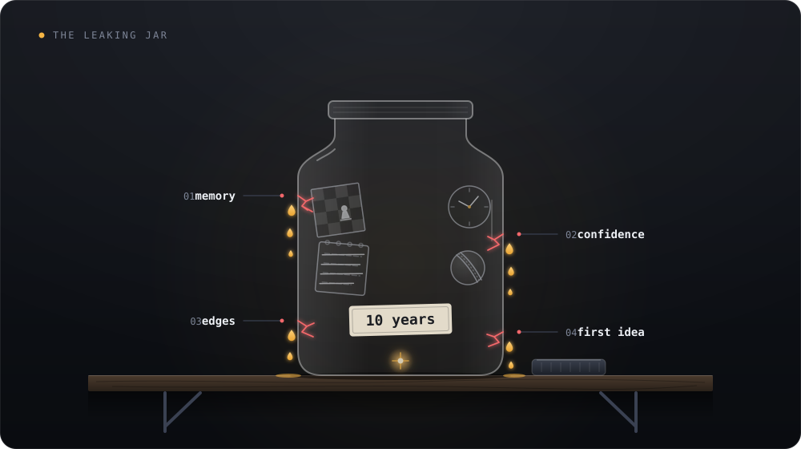

The first leak is memory. In 1972, before President Nixon's trips to China and the Soviet Union, researchers asked people how likely various outcomes were. Afterwards, they asked them to recall their own predictions. People remembered giving higher odds to the things that had actually happened than they really had ([Fischhoff & Beyth 1975, summary](https://en.wikipedia.org/wiki/Hindsight_bias)).

We all do this with hunches. The ones that came true become stories we tell. The ones that didn't quietly fade. Dumbledore would just check the Pensieve. The rest of us need the hunch log, which is basically a cheap Pensieve for predictions.

The second leak is confidence. Kahneman's warning is that confidence shows up whether or not it has earned its place ([McKinsey interview with Kahneman & Klein](https://www.mckinsey.com/capabilities/strategy-and-corporate-finance/our-insights/strategic-decisions-when-can-you-trust-your-gut)). In an old study, clinicians were given more and more information about a case. Their confidence climbed. Their accuracy stayed stuck around 26% ([Oskamp 1965, summary](https://web.csulb.edu/~cwallis/382/certainty/chapter19.html)). Even our instincts about our own learning can be wrong, as the 78% in the painting study showed.

The third is that expertise has edges you can't see. In Kahneman's words, experts "don't know exactly where the boundaries of their expertise are". Think of the chess masters looking at random boards. Their instinct didn't fade gently. It just stopped working, and nothing inside would have warned them.

This worries me as a product builder. Taste moves. A pattern I learned about users five years ago might be quietly wrong today, and it would still feel exactly as sure.

The fourth is that the first good idea can block a better one. In one experiment, strong chess players were shown a position with a familiar five-move checkmate. There was also a shorter, three-move mate on the board. None of them found it. Eye-tracking showed their eyes kept drifting back to the squares of the familiar solution, even while they said they were looking for something better. That one familiar idea dragged their play down to the level of much weaker players ([Bilalić, McLeod & Gobet 2010](https://cognition.aau.at/download/Publikationen/Bilalic/Bilalic_etal_2010b.pdf)).

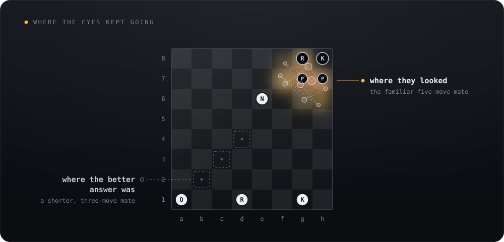

Instinct is fast because it grabs the first pattern that fits. Sometimes that's exactly the problem. Klein's fix is the premortem: before you commit, imagine the plan has already failed, then list the reasons why ([same McKinsey interview](https://www.mckinsey.com/capabilities/strategy-and-corporate-finance/our-insights/strategic-decisions-when-can-you-trust-your-gut)).

And not every gut feeling is stored time at all. Some of what feels like intuition is just mood, fear, or familiarity. Across more than 40 million car sales, people bought more convertibles and four-wheel drives depending on that day's weather ([Busse et al. 2015](https://ideas.repec.org/a/oup/qjecon/v130y2015i1p371-414.html)). Nobody buying a convertible on a sunny day thinks "the weather made me do it". It feels like a gut call. It's just the weather.

To be fair, the science has its own leaks. Some of the studies I've leaned on are small. The flight study had 14 people. The idea that the body knows before the mind in the gambling task is disputed. The sleep boost may be partly an artifact. The one-in-six rule was proved for model learners, not people. Practice itself explains only part of skill: about 26% of the differences between people in games, 18% in sports, and under 1% in professions ([Macnamara, Hambrick & Oswald 2014](https://pubmed.ncbi.nlm.nih.gov/24986855/)). And almost every clean number in this piece comes from a kind world, where someone could actually count. The messier worlds most of us work in mostly have no count at all.

I started with two questions. How do we capture time? And would that even be wonderful?

So, can it be done? Not the way the stories hoped. You can't pour hours into a jar. But you can live a moment closely enough that something stays behind.

Each story grabbed a piece of the answer. Hermione got extra hours, but hours alone don't stay. The Pensieve kept every memory, but a memory isn't a skill. Neo got the skill, but still had to walk the path. Only the loops got the whole thing: a situation, a call, an honest answer, and again, and again. Phil Connors didn't walk out of February 2nd carrying 30 years. He walked out carrying what 30 years had taught him, folded so small it fit into the next second.

The real world is full of smaller loops. The batsman who reads the bowler's wrist before the ball leaves the hand. The fire lieutenant who hears a silence and gets his crew out. The chick sexer who is almost never wrong and can't tell you why. None of them is guessing. Each is spending years in a moment.

So, would it be wonderful? Yes, with conditions. What you store is only as good as the feedback that wrote it. The jar leaks through memory. It can't see its own edges. And it can be crowded out by the first familiar idea. But you can fill it on purpose. Find the kind corners of your world. Build small loops. Miss about once in six. And write your hunches down before the world answers them.

If time could take a shape you could carry around, I think it would look like this. Not a jar or an hourglass. A quiet certainty that turns up before the reasons do, holding years it can't explain, and asking you to trust it a little, and check it often.


We were never going to bottle the clock. But we've been doing the next best thing all along.

Instinct is the stored time.

## A hunch log to copy

One row per hunch, written down before you know the answer. Paste the table into a spreadsheet or Notion, or copy the blank version below into your notes.

| Date | The call | Confidence | Cue I noticed | Check on | What happened | Score |
| --- | --- | --- | --- | --- | --- | --- |
| Nov 09 | This onboarding change will lift day-one completion. | 70% | Users kept stalling on the permissions screen. | Nov 23 | | |
| &nbsp; | | | | | | |
| &nbsp; | | | | | | |

```markdown
| Date | The call | Confidence | Cue I noticed | Check on | What happened | Score |
| ---- | -------- | ---------- | ------------- | -------- | ------------- | ----- |
|      |          |            |               |          |               |       |
```

To score a row, take your confidence as a number between 0 and 1, subtract what happened (1 if it did, 0 if it didn't), and square it. Zero is perfect, and 0.25 is what "50%" about everything would earn.

## Further reading

Every source is linked where it's used in the text. These are the ones worth reading next.

**Intuition as recognition**

- **Simon & Chase (1973)**, *Skill in chess*. The real-board and random-board experiments, and the pattern library behind expert intuition. [Read](https://www.Gwern.net/doc/psychology/chess/1973-simon.pdf)
- **Klein (2008)**, *Naturalistic decision making*. How fire commanders and other experts actually decide: recognise the situation, take the first option that fits, play it out in their heads. [Read](https://library.alnap.org/system/files/content/resource/files/main/Klein_2008_HF_NDM.pdf)
- **Kahneman & Klein (2009)**, *Conditions for intuitive expertise: a failure to disagree*. Intuition's great sceptic and its great champion agree on when a gut feeling can be trusted. [Read](https://pubmed.ncbi.nlm.nih.gov/19739881/)
- **McKinsey Quarterly (2010)**, *Strategic decisions: when can you trust your gut?* The same two in conversation. The easiest way in, and where the premortem comes from. [Read](https://www.mckinsey.com/capabilities/strategy-and-corporate-finance/our-insights/strategic-decisions-when-can-you-trust-your-gut)

**Feedback and practice**

- **Hogarth, Lejarraga & Soyer (2015)**, *The two settings of kind and wicked learning environments*. Why some worlds teach you and others quietly teach you the wrong lesson. [Read](https://pure.mpg.de/pubman/item/item_2225074_9/component/file_3569491/Hogarth_TheTwo_2015_VerlPDF_final_LS.pdf)
- **Ericsson (2006)**, *The influence of experience and deliberate practice on the development of superior expert performance*. The deliberate practice research, including the Berlin violinists, in its author's own words. [Read](https://www.ida.liu.se/~nilda/Anders_Ericsson/Ericsson_delib_pract.pdf)
- **Macnamara, Hambrick & Oswald (2014)**, *Deliberate practice and performance in music, games, sports, education, and professions*. The counterweight: how much of the difference between people practice actually explains, field by field. [Read](https://pubmed.ncbi.nlm.nih.gov/24986855/)
- **Wilson et al. (2019)**, *The Eighty Five Percent Rule for optimal learning*. Where "miss about once in six" comes from, and the assumptions it rests on. [Read](https://escholarship.org/content/qt0v22s4g4/qt0v22s4g4.pdf?t=sdxgqm)
- **Bjork & Bjork (2023)**, *Introducing desirable difficulties into practice and instruction*. Spacing, mixing and testing yourself, written for people who want to use them. [Read](https://www.unh.edu/teaching-learning-resource-hub/sites/default/files/media/2023-06/itow-introducing-desirable-difficulties-into-practice-and-instruction-bjork-and-bjork.pdf)

**Training a hunch**

- **Mellers et al. (2014)**, *Psychological strategies for winning a geopolitical forecasting tournament*. What the superforecasters did differently, and how a short training made forecasters more accurate. [Read](https://escholarship.org/content/qt4rg4n9vr/qt4rg4n9vr_noSplash_4ff67e56b3dac616e0163b75090705e6.pdf)
